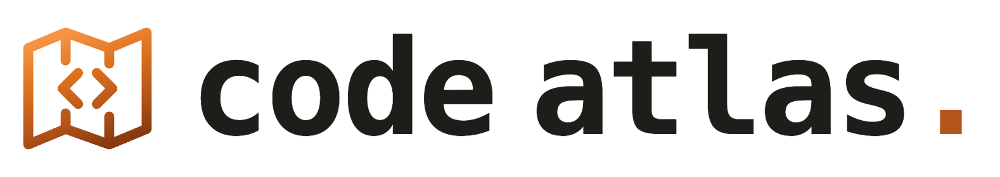
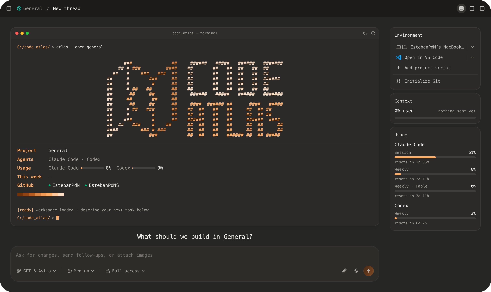

<h1 align="center">
  <picture>
    <source media="(prefers-color-scheme: dark)" srcset="docs/images/code-atlas-logo-dark.png">
    
  </picture>
</h1>

A Mac workspace for coding agents, with local voice dictation and organized projects. Based on T3 Code.

  
  
  
  

  

Code Atlas is a personal edition of [T3 Code](https://github.com/pingdotgg/t3code) 0.1.1 for macOS. It controls the coding agents you already use, such as Claude Code and Codex, with the look and method of the [Code Atlas handbook](https://code-atlas.estebanpdn.chatgpt.site/).

This project was developed with the help of [OpenAI Codex](https://openai.com/codex/) and [Claude Code](https://claude.com/product/claude-code). Learn more about the development process [here](AI_DEVELOPMENT.md).

## Download

**v1.2 · macOS 13+ · Apple Silicon.** Move the app to Applications and follow the [installation guide](docs/getting-started.md).

Code Atlas is ad-hoc signed and not notarized: on first launch, choose **Open Anyway** in System Settings → Privacy & Security. It does not update itself; to update, replace the app in Applications with the new version. Settings, projects, threads and groups carry over.

## Features

- Work with Claude Code, Codex and the other agents T3 Code supports, using your own subscriptions.
- Dictate locally in Spanish, English and Portuguese, including mixed programming vocabulary, with Whisper running on the Mac GPU. Right-click the microphone to choose the input.
- Organize projects in collapsible groups with drag and drop and their own icons, and keep Pinned and Needs attention threads at the top. Your folders are never moved.
- Start each thread from the Code Atlas terminal: project, agents, weekly usage, this week's commits and GitHub accounts.
- Follow a running agent in the Claude Code style: it plans every request as a task list, shown as a card with one live line for time, tokens and the current step. Pause, resume or stop it from the composer.
- See the context window row by row and your Codex and Claude Code limits beside the conversation and in the usage statistics.
- Keep Environment, Context and Usage beside the conversation.
- Run alongside T3 Code with separate data in `~/.code-atlas`.

[Documentation](docs/getting-started.md) · [Changelog](CHANGELOG.md) · [Contribute](CONTRIBUTING.md)

## Bug reports

[Open an issue](https://github.com/EstebanPdNS/Code-Atlas/issues/new?template=bug_report.md) with the app version, macOS version, the agent you were using, reproduction steps and a screenshot. Remove private paths, tokens and personal content.

---

[MIT license](LICENSE) · [Image credits](docs/images/README.md) · [T3 Code](https://github.com/pingdotgg/t3code)

Code Atlas is an independent project based on T3 Code 0.1.1 by T3 Tools Inc. (MIT). It includes the local dictation work from T3 Code pull request #19273 by Wout Stiens and [whisper.cpp](https://github.com/ggml-org/whisper.cpp) with OpenAI's Whisper model. It is not affiliated with or endorsed by T3 Tools, Anthropic or OpenAI.
